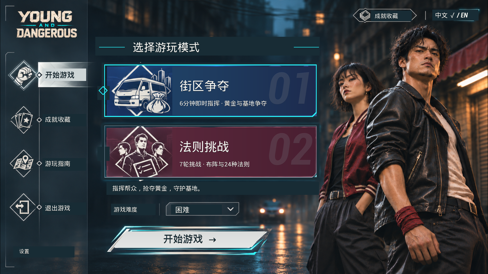
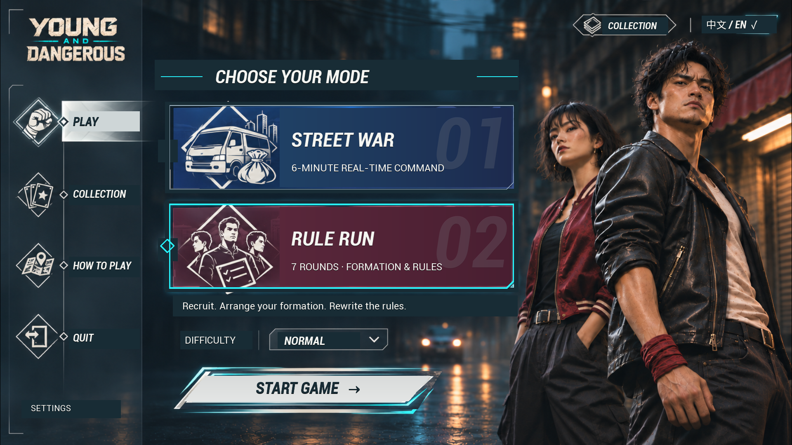

# 九龙街区 · KowloonFgame

UE 5.8.3 Windows战术游戏，包含街区争夺和七轮法则挑战，支持中文 / English 与本地成就收藏。

## 最新下载（2026-11-25）

- **[下载Windows游戏ZIP](https://github.com/XinDunHam/KowloonFgame/releases/download/v2026.11.25-home-ui/KowloonFgame-Windows-20261125.zip)**：完整解压，运行最外层KowloonFgame.exe，无需UE编辑器。
- **[下载完整UE工程ZIP](https://github.com/XinDunHam/KowloonFgame/releases/download/v2026.11.25-home-ui/KowloonFgame-UE5-Project-20261125.zip)**：含Content、Source、Config、Scripts、Build与生产源资源。
- [游玩指南](https://github.com/XinDunHam/KowloonFgame/releases/download/v2026.11.25-home-ui/Gameplay-Guide-zh-CN.txt) · [SHA256校验值](https://github.com/XinDunHam/KowloonFgame/releases/download/v2026.11.25-home-ui/SHA256SUMS.txt) · [本版发布页](https://github.com/XinDunHam/KowloonFgame/releases/tag/v2026.11.25-home-ui)

公开下载无需登录。GitHub自动生成的Source code.zip只含代码仓库，完整可编辑工程请下载上面的专用UE5-Project附件。

## 新版首页

按新参考图改为左侧导航、中央双模式卡片、难度下拉、右上收藏与语言、底部开始按钮。保留人物街景原画，复用原UI包的金属按钮状态与动效，可变文字使用实时字体。进入游戏后，先选择模式和难度，再点击开始。法则挑战说明同步为7轮和24种法则。

## 两种玩法与操作

- 街区争夺最长6分钟。500黄金保持15秒、摧毁敌方基地车或钻石运回基地获胜；4分钟进入后期，宽限10秒后失去老大会败北，NPC伤害提升；4分30秒钻石车带4名护卫出现。
- 法则挑战最多7轮，包含24种法则，每次三选一可免费刷新整组一次；战前布阵、招募和商店补给。
- 俯视右键选兵、拖框多选，再右键地面/敌人/基地下令；Shift追加。Z/X/C改变后续出兵路线。街区Tab切换3D、F2返回全图；法则挑战Tab切换倍速。F1指南，ESC暂停。

[详细游玩指南](Docs/Gameplay-Guide-zh-CN.txt) · [首页实现说明](Docs/参考图首页重做.md)

## 编辑与构建

完整工程需自行安装UE5.8（本版实测5.8.3）、Visual Studio 2022 C++工具链，选择自己的引擎并生成项目文件，启用PCG插件。直接克隆本代码仓库不含完整Content，不能替代专用工程ZIP。

使用Scripts/PackageGame.ps1构建；TestHomeUI.ps1提供首页专项检查，TestRuleRun.ps1、TestStreetWar.ps1、TestStreetTactics.ps1提供玩法回归入口。游戏包不含开发者测试存档；工程包排除缓存、历史构建及冗余测试截图，保留生产资产与源资源。

项目所有者确认Abandoned_Hong-Kong街景为自制。已有第三方许可随资源保留；UE与Epic内容仍适用原条款。项目尚未指定额外开源许可证，公开下载不等于无限制商业或素材再分发授权。

本次首页构建通过，1920×1080、1600×900专项检查与双模式进出回归通过。之前版本的七轮法则、战术拾取和分页指南功能保留。当前为开发试玩版，测试范围不涵盖所有硬件和玩法组合。
