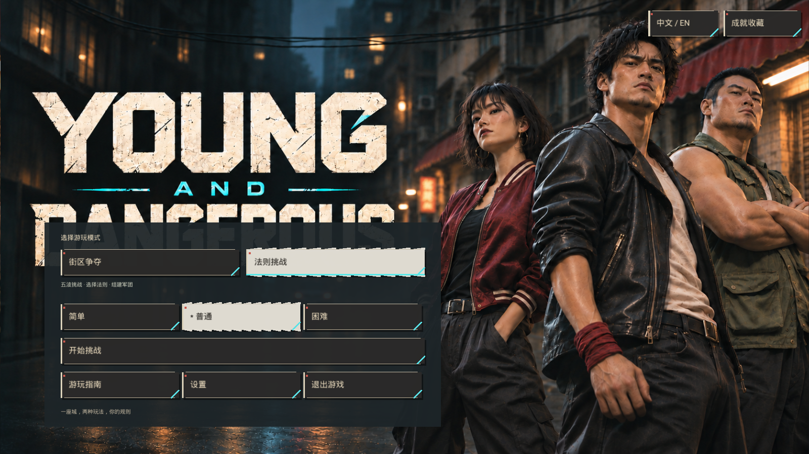

# 九龙街区 · KowloonFgame

UE 5.8.3 制作的 Windows 帮派战术游戏，包含「街区争夺」与「法则挑战」。当前发布为开发试玩版，支持中文 / English 与本地成就收藏。

## 直接下载

- **[下载 Windows 游戏 ZIP（约732 MB）](https://github.com/XinDunHam/KowloonFgame/releases/download/v2026.11.22-bilingual/KowloonFgame-Windows-20261122.zip)**
- **[下载完整可编辑 UE 工程 ZIP](https://github.com/XinDunHam/KowloonFgame/releases/download/v2026.11.22-bilingual/KowloonFgame-UE5-Project-20261122.zip)**
- **[下载中文游玩攻略与操作指南](https://github.com/XinDunHam/KowloonFgame/releases/download/v2026.11.22-bilingual/Gameplay-Guide-zh-CN.txt)**
- [查看本版发布页](https://github.com/XinDunHam/KowloonFgame/releases/tag/v2026.11.22-bilingual)

公开仓库和 Release 附件可供其他人直接下载。**试玩请选择 Windows 游戏 ZIP；不是 GitHub 自动生成的 Source code.zip。** 完整 UE 工程也通过上面的专用工程 ZIP 提供，包含 Content 与源资源；本仓库保留代码、配置、构建脚本及文档，避免将大型资产塞进 Git 历史。

## 运行

完整解压游戏 ZIP，双击最外层 `KowloonFgame.exe`。保留旁边的 `Engine`、`KowloonFgame` 文件夹；游玩不需要 UE 编辑器。

点击封面进入主菜单，右上角「中文 / EN」切换语言，「成就收藏 / COLLECTION」查看8项成就。语言和成就保存于游戏 `KowloonFgame/Saved/PlayerProfile.json`。发布包不附带开发者测试档案。

## 两种玩法

- **街区争夺 / Street War**：六分钟即时指挥。抢夺随机黄金、拦截运金车、护送钻石、进攻基地车；决战阶段保护老大。
- **法则挑战 / Rule Run**：五关战术闯关。战前逐个布阵，招募近战和枪手，胜利后三选一物理法则，通过商店扩充军团。
- 主菜单、教学、法则挑战及收藏页支持双语；文字放大，选中按钮采用纸质风格。
- 原画内嵌文字、街景招牌及开发日志保留其原文。

## 操作要点

- 法则挑战：左键己方单位，再点蓝方地面布阵；空格开战；右键地面移动、右键敌人集火；右键拖框多选；中键旋转。
- 街区俯视：右键己方单位或老大选中、拖框多选，再右键地面、敌人或基地下令。
- Shift追加选择；ESC暂停；F1教学；N重开当前模式。
- **Tab在法则挑战战斗中是变速，在街区模式中是切换俯视/街景。**
- 详细攻略见 [游玩指南](Docs/游玩指南/游玩攻略与操作指南.txt)。

## 编辑与构建

请下载「完整可编辑 UE 工程 ZIP」并完整解压。它含 `Source`、`Config`、`Content`、`Build`、`Scripts`、`SourceAssets` 与 `.uproject`，不包含 UE 引擎安装目录、缓存、历史发布包或个人存档。直接克隆本代码仓库不含完整 Content，不能替代完整工程包。

本版实测 UE 5.8.3、Visual Studio 2022 C++ 工具集14.44与 Windows SDK 10.0.26100.0。请安装自己的 UE，右键 `.uproject` 选择对应引擎版本并生成项目文件；PCG插件需要启用。工程的 EngineAssociation 已使用通用的 `5.8`，不依赖开发机的引擎GUID。

`Scripts/PackageGame.ps1 -EngineRoot "你的UE安装目录" -Release "新版本目录名"` 用于构建和打包；`TestRuleRun.ps1`、`TestStreetWar.ps1`、`TestBilingualUI.ps1` 提供回归入口。已有地图可直接打开；`BuildPrototype.ps1`会生成资产和地图，修改工程前请保留自己的工作副本。

## 内容与许可

项目所有者确认香港街景包 `Abandoned_Hong-Kong` 为自制内容。工程内已有的第三方许可证和说明随资源保留；Unreal Engine 与相关 Epic 内容仍适用其原有条款。本项目尚未指定额外开源许可证，公开下载不等于对所有素材授予无限制再分发或商业授权。

## 当前版本

2026-11-22 双语收藏版。发布前完成132项功能/档案检查、3局完整对局及启动与画面检查。这是当前测试范围，设备适配、数值平衡和美术表现仍可继续改进。
