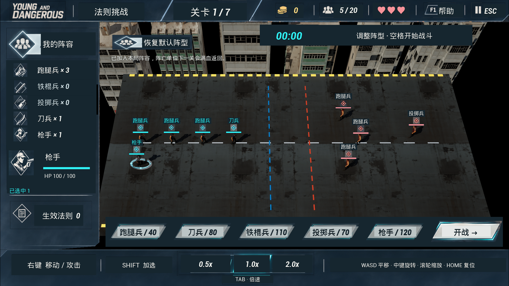
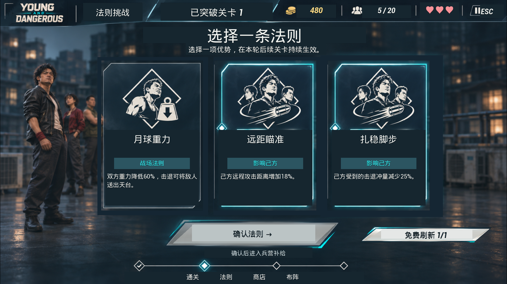

# 九龙街区 · KowloonFgame

UE 5.8.3 Windows战术游戏，包含街区争夺和七轮法则挑战，中英文与本地成就收藏。

## 最新下载（2026-11-23）

- [Windows游戏 ZIP](https://github.com/XinDunHam/KowloonFgame/releases/download/v2026.11.23-gameplay/KowloonFgame-Windows-20261123.zip)：完整解压后运行最外层KowloonFgame.exe，无需UE编辑器。
- [完整UE工程 ZIP](https://github.com/XinDunHam/KowloonFgame/releases/download/v2026.11.23-gameplay/KowloonFgame-UE5-Project-20261123.zip)：包含Content、Source、Config、Scripts、Build与SourceAssets。
- [最新游玩指南](https://github.com/XinDunHam/KowloonFgame/releases/download/v2026.11.23-gameplay/Gameplay-Guide-zh-CN.txt)；[校验值](https://github.com/XinDunHam/KowloonFgame/releases/download/v2026.11.23-gameplay/SHA256SUMS.txt)。
- [发布页](https://github.com/XinDunHam/KowloonFgame/releases/tag/v2026.11.23-gameplay)

公开下载无需登录。GitHub自动生成的Source code.zip只含代码仓库，完整工程请下载专用UE5-Project附件。

## 本版内容

血条上方兵种名称、动态选中名称与血量；24种法则、每次法则三选一免费整组刷新一次、最多7轮；敌方防守、护送、争车和拦截分工；拾取超时释放、路径恢复；紧凑高清UI与双语分页游玩指南。

街区争夺最长6分钟，500黄金保持15秒、摧毁敌方基地车或钻石运回基地获胜。4分钟进入后期，宽限10秒后失去老大会败北，NPC伤害提升；4分30秒钻石车带4名护卫出现。

俯视右键选兵、拖框多选，再右键地面/敌人/基地下令，Shift追加。Z/X/C仅改变后续出兵路线。街区Tab切换3D、F2返回全图；法则挑战Tab切换倍速。F1打开当前模式指南，ESC暂停。

## 构建和资源

完整工程需要自行安装UE5.8（本版实测5.8.3）及Visual Studio 2022 C++工具链，选择自己的引擎后生成项目文件。PCG插件需启用。使用Scripts/PackageGame.ps1构建；TestRuleRun.ps1、TestStreetWar.ps1、TestStreetTactics.ps1等提供回归入口。

项目所有者确认Abandoned_Hong-Kong街景为自制。已有第三方许可随资源保留；UE与Epic内容仍适用原条款。项目尚未指定额外开源许可证，公开下载不等于无限制商业或素材再分发授权。

本版经过法则流程、战术/拾取、双模式、UI输入和实机画面回归，并完成3局法则物理对战与360秒街头模拟。仍为开发试玩版，测试不代表所有硬件、地图摆放和玩法组合均无问题。
